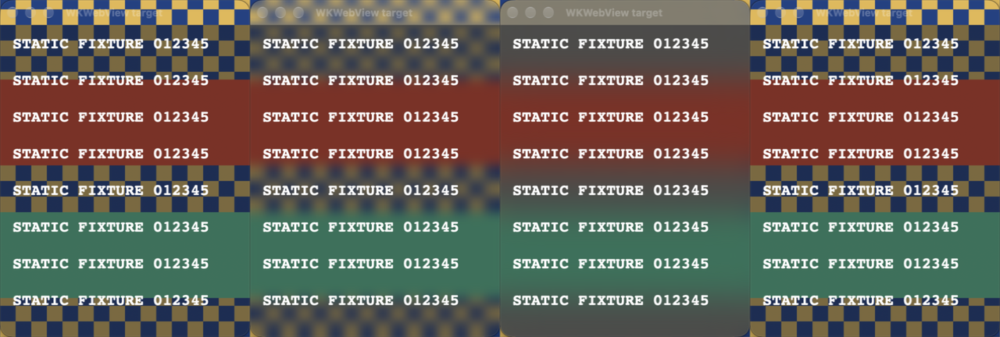

# Case study: eliminating the macOS blur-enable flash

**Historical investigation and implementation record — October 17–18, 2026.**
The solution was merged locally and exercised in a native fixture. The user also
observed the final standalone surfaces without flicker. This is **not packaged
Nimrod acceptance**. Follow the current [translucency specification](../translucency.md)
and [verification status](../verification.md) for the maintained contract and gaps.

## Outcome in one paragraph

Nimrod's `0 → nonzero` blur flash was reproducible using the private
`CGSSetWindowBackgroundBlurRadius` call in a standalone AppKit program, with no
Nimrod settings, web UI or theme code involved. Timing/batching and window-backing
variations did not eliminate it. Zed's different native path provided the useful
lead: `NSVisualEffectView`, with material tint and extra saturation removed. We
extended that policy to adjustable Gaussian blur, discovered that filters must be
**copied and replaced rather than mutated in place**, then integrated a window-owned
implementation covering content and the native title bar. The final probe linked
that exact implementation and exercised activation, removal, resize, appearance,
hidden startup and close cleanup without capturing the original grey frame.

## 1. The asymmetric symptom was the clue

The user reported that changing blur from **zero to nonzero** flickered every
project window; changing it back to zero did not. Earlier work had already:

- Separated blur strength from theme-background opacity.
- Stopped reapplying an unchanged native theme and title-bar tint on radius ticks.
- Used an almost-clear backing instead of exact `clearColor`. The user confirmed
  that this improved the square-backdrop/corner problem, but the flash remained.
- Wrapped the radius setter in `SLSDisableUpdate`/`SLSReenableUpdate`.

Thus the corner/shadow fix was not a flash fix, and another speculative theme or
redraw change was not justified. Source inspection also showed that global preview
makes every window independently apply its radius; “all project windows” did not
by itself prove one native setter was disturbing all peers.

## 2. Isolate the native operation, not just the JavaScript

The [standalone probe](../../../../../tools/blur-probe/README.md) creates:

1. An opaque blue/yellow synthetic checkerboard backdrop.
2. A transparent plain AppKit target.
3. A transparent WKWebView target with static inline content.
4. A separate unchanged WKWebView control.

It changes the two targets independently, then together, using real zero, 7 and 20.
It does not open Nimrod, start an agent, read a conversation, navigate a browser or
load remote page content. Native work was explicitly authorized by the user.

On macOS **27.0.1 (26A434), Apple Silicon**, the original setter could produce one
captured **flat-grey backdrop frame**, followed by correct blur. Foreground text
remained present. Both target types reproduced it. The unchanged control stayed
stable. No such frame was captured at `7 → 20` or `nonzero → 0`.


**Conclusion supported by the evidence:** the selected native blur-enable path was
sufficient to produce the artifact. **Not established:** the exact internal
WindowServer allocation/rendering bug, behavior on every macOS release, or an
unavoidable limitation of all macOS blur implementations.

### Recording itself produced two important traps

- **TCC attribution and binary identity:** direct execution could attribute Screen
  Recording to the hosting Nimrod/terminal. LaunchServices gave the probe its own
  identity. Rebuilding an ad-hoc binary invalidated the original `cdhash` grant;
  toggling the checkbox did not replace its stored requirement. The diagnostic
  bundle adopted a stable designated requirement, then only its own grant was reset
  and reapproved. This is probe setup, not a production signing recommendation.
- **Filtered capture is not actual display composition:** ScreenCaptureKit's
  own-window filter substituted persistent grey for nonzero legacy blur, even
  when the real display showed the blurred backdrop. That mode could not validate
  this effect. Actual evidence used cropped display capture inside the fixture's
  opaque elevated backdrop. No user-app/session content or audio was recorded.

A later addition put large red/green bands behind the targets. Fine checkerboards
can blur into nearly uniform grey; coarse landmarks distinguish real backdrop
sampling from an opaque grey substitute.

## 3. Record the failed experiments so they are not rediscovered

The original [experiment matrix](../../../../../tools/blur-probe/README.md#native-evidence-2026-10-17)
contains per-run counts. Every narrow variation below still reproduced the flash:

| Attempt | Finding |
| --- | --- |
| Connection-scoped update batch | Did not suppress the grey frame |
| Alternate blur style 0 | Still flashed |
| No native shadows | Still flashed; not the earlier corner/shadow bug |
| Black backing alpha .001 instead of .0001 | Still flashed |
| Whole-window alpha .999 | Still flashed; also not an acceptable product-opacity workaround |
| Opacity-hint setter, hints .0001 and 1 | Still flashed |
| CATransaction flush | Still flashed |
| Explicit display plus flush | Still flashed |
| Disable AppKit auto-flattening | Still flashed |
| Disable flattening and rehost layers during setup | Still flashed |

We did **not** redefine zero to a small positive blur, cover the transition with a
screenshot, hide/recreate the user's windows, or change their geometry. Those would
change the product contract or conceal the defect rather than establish a solution.
A persistent backdrop was considered as a direction, not declared a working fix;
the eventual solution did not require retaining an effect at zero.

## 4. Read live-update code in upstream applications

The [upstream comparison](../../../../../tools/blur-probe/upstream-comparison.md)
retains exact source permalinks, live-settings call chains, issue references and
experiment results. Source snapshots were pinned, not left as moving `main` links:

| Repository | Revision | Relevant result |
| --- | --- | --- |
| Ghostty | `73e4ff10fb2b30d1ab6e6f7f52ef33f3a0593dcc` | Numeric blur still uses the same WindowServer setter |
| Zed | `56934ec0560bce8929025497411de7f5322fb6ca` | Live blur uses a cleaned NSVisualEffectView instead |

Ghostty's thread-default connection, white .001 backing and repeated appearance/
shadow/backing setup were transplanted into the fixture; all still flashed. The
thread-default and main connection IDs were equal in that measured main-thread
setup. Ghostty's visibility/post-show fixes concerned startup, not demonstrated
acceptance of this enable-only artifact. Its actual renderer/app was not run, so
these results do not claim Ghostty itself flashes.

Zed's SettingsStore observer really does update existing windows. Its backend
inserts/removes an effect view, using `UnderWindowBackground`, `BehindWindow` and
`Active`. After AppKit's layer update it clears layer fills, hides the desktop-tint
`CAChameleonLayer` and removes extra saturation. Its source specifically notes that
an older `Selection` material no longer supplies a backdrop layer on macOS 27.
Zed's upstream implementation is **fixed material blur**, not our numeric extension.

Bounded issue searches did not identify a documented macOS fix for this exact grey
frame. Shadow/corner, tab/pane, startup, display-reconnect and Windows-only reports
were distinguished rather than presented as evidence that the bug was solved.

## 5. The decisive implementation detail: replace the filter

The cleaned material path showed no captured grey activation frame. Stock material
also avoided that frame in the fixture, but imposed a visibly dense tint, so it
could not preserve Nimrod's independent background-opacity behavior.

Our first adjustable-material experiment assigned `inputRadius` to the installed
Gaussian filter. The calls and logs looked successful, but crops at 7 and 20 were
**byte-identical**. A successful property assignment was not proof of rendered effect.

The working sequence was:

```text
AppKit updateLayer
  → inspect only the owned material's layer subtree
  → remove tint/extra saturation
  → copy the Gaussian filter
  → set inputRadius on the copy
  → replace the layer's filter array
```

That changed the pixels: 7 softened the backdrop, 20 softened it more, and removing
the view restored sharp checkerboard/band edges. Across three copied-filter prototype
runs, **18 target enables / 2,215 captured frames** contained no detected grey frame.
An interleaved original-setter control still reproduced it. Capture could miss
refreshes, so these counts are supporting evidence, not a universal flicker-free claim.

## 6. Move from a prototype to code the app actually uses

Implementation commit: **`8a9b656`** (merged via `59d1fd8`).

| File | Responsibility at integration |
| --- | --- |
| [`macos_blur.m`](../../../../../src-tauri/src/macos_blur.m) / [header](../../../../../src-tauri/src/macos_blur.h) | Owned native effect, filter copies, main-thread/exception boundary, frame placement, zero/close cleanup |
| [`macos_window_appearance.rs`](../../../../../src-tauri/src/macos_window_appearance.rs) | Window-local theme/backing/title tint and native helper bridge |
| [`window_appearance.rs`](../../../../../src-tauri/src/window_appearance.rs) | Invoking-window command dispatch and capability/accessibility handling |
| [`native-window-appearance.ts`](../../../../../src/native-window-appearance.ts) | Serialized bridge, request-scoped late-error handling and listener disposal |
| [`build.rs`](../../../../../src-tauri/build.rs) | macOS-only Objective-C compilation through `cc`, ARC and blocks |

“Production helper” means that first source file, **not a second approximation of
it**. The probe's `production` mode compiles and calls the same `.m` file as Nimrod.

Important integration decisions:

- Put the effect at the bottom of the validated native frame parent, not just the
  content rectangle. This includes the Transparent native title bar without
  reparenting WKWebView, moving controls or changing content geometry.
- Keep one associated owner per NSWindow. Reuse the view for positive strengths;
  zero completely detaches it. Resize/fullscreen-completion observers maintain its
  host/frame; Close removes the view, callback and observers. It cannot hit-test or
  become first responder.
- Reapply numeric state after AppKit rebuilds its material. Bound the traversal and
  catch Objective-C exceptions before returning across Rust FFI.
- Fail to plain transparency, not a stock tinted material. Initial failures return
  through the command; later failures hide/latch the owned effect and report to
  that window's existing application notice strip.
- Fence late failures with a per-call UUID. Another window, an old request, a reply
  following an earlier failure, or a disposed listener must not corrupt current state.
- Preserve window-local theme handling, the .0001 backing and independent CSS tint.
  Remove the old radius setter and connection-wide update suppression from the app.

## 7. Evidence at handoff

Native runs using the actual production helper, on the same macOS host:

| Run | Captured frames | Result |
| --- | ---: | --- |
| Basic activation/strength/removal | 782 | No captured grey frame |
| Resize while blurred | 774 | No captured grey frame |
| Dark/light appearance changes | 754 | No captured grey frame |
| Combined lifecycle | 655 | No captured grey frame; ownership/input/frame/close assertions passed |
| Hidden preparation, separately | Not used as a transition count | Setup succeeded while `visible=0`; completed without helper errors |

The lifecycle assertions covered one owned effect at nonzero/none at zero, unchanged
content-view/first-responder identity, declined hit testing, full frame coverage,
invalid radius/null rejection and removal when closing a still-blurred window.



This contact sheet preserves target-only crops from `production-basic` frames
107/441/497/556 (phases 0/6/7/8). All content is synthetic. Raw PNGs, CSVs and logs
remain ignored under the retained task worktrees' `tmp/blur-probe/`; representative
images, source and written results are tracked, so the findings do not depend on
retaining every temporary capture.

**Direct user observation, recorded October 18:** after watching the standalone
blue/checkerboard program, the user reported: “I saw towards the end, both mac
surfaces didn’t have the flicker.” This adds human visual confirmation for the
standalone AppKit/WKWebView fixture. It does not identify every run/variant or
establish packaged Nimrod acceptance.

The production integration passed the required `mise run check` (TypeScript/Rust
compilation). New JS/native source regression fixtures were authored but unrun at
handoff. No Nimrod package was built/restarted as part of the integration, and no
live conversation or provider request was used to validate it.

## 8. What remains, and how to avoid repeating the detour

At handoff, packaged Nimrod still needed verification of fullscreen/minimization,
all opacity/theme combinations, Reduce Transparency, native input/scroll and streaming
performance. Private filter/material details still require runtime fallbacks and
OS-version maintenance. Linux/Windows acceptance was not established by these macOS
runs. Consult the current specification rather than freezing this historical list.

Lessons worth preserving:

1. A native-only reproduction can disprove an attractive frontend-race explanation.
2. An unchanged control distinguishes per-window transitions from cross-window damage.
3. Screen-capture modes can change the very effect being investigated.
4. Trace upstream **live changes**; startup workarounds answer a different question.
5. Verify rendered pixels, not just native return codes and assigned properties.
6. Test the production source after the prototype works, including ownership and errors.
7. Record failed approaches and the scope of success; “no frame captured,” direct
   visual confirmation and full packaged-app acceptance are different evidence.

## Navigation and revision anchors

- [Current feature contract](../translucency.md) / [current verification](../verification.md).
- [Probe setup and original failure matrix](../../../../../tools/blur-probe/README.md).
- [Pinned upstream sources and prototype details](../../../../../tools/blur-probe/upstream-comparison.md).
- [User guide](../../../../../docs/translucency.md) / [explicit diagnostic setup](../../../../../CONTRIBUTING.md#native-blur-diagnostic).
- `66b9b8c`: standalone reproduction and original evidence.
- `c6a27f7`: Ghostty/Zed comparison and adjustable-material prototype.
- `8a9b656`: production material-backed integration.
