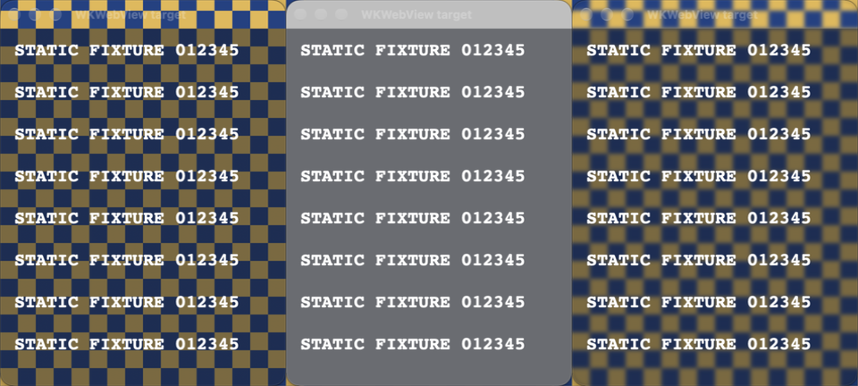

# Isolated macOS blur probe

For the complete symptom → investigation → solution narrative, see the
[macOS blur case study](../../.agents/skills/features/references/history/macos-blur-enablement.md),
including failed experiments, capture pitfalls, production integration and the
user's direct visual confirmation. This README owns probe operation and its matrices.

Explicit developer diagnostic, **not part of `mise run test` or Nimrod**. It creates a
synthetic checkerboard, one AppKit target, one transparent WKWebView target and an
unchanged WKWebView control. No Nimrod process/session/configuration is accessed.
Web content is an inline static string with an ephemeral data store. No audio is captured.

## Run

Requires macOS with ScreenCaptureKit, current Xcode Command Line Tools, and manual
Screen Recording approval for **Nimrod Blur Probe**. Only the local macOS 27.0.1 /
Apple Silicon environment below has been exercised; this is not a portable test.
From a task worktree:

```sh
bash tools/blur-probe/probe.sh build
mkdir -p tmp/blur-probe/example
printf '%s\n' '{"displayCapture":true}' > tmp/blur-probe/example/options.json
bash tools/blur-probe/probe.sh run tmp/blur-probe/example batch
python3 tools/blur-probe/summarize.py tmp/blur-probe/example
```

The first run may exit after requesting permission. Approve and rerun. Launch with
this script/LaunchServices, not by executing the bundled binary directly: direct
execution can attribute TCC to the hosting terminal or Nimrod. The bundle uses a
stable **diagnostic-only** designated requirement before the initial grant. If an
older probe grant stored an ad-hoc `cdhash`, toggling its checkbox does not replace
the requirement; remove/reset **only `dev.nimrod.blur-probe`** and approve again.
Do not reset Nimrod's or other applications' permissions. Normal builds/runs do not
reset permissions, modify a keychain, or change Nimrod's signing configuration.

Always use a fresh output directory. Each run takes approximately 17 seconds and
writes local lossless PNGs, per-frame region means and a log. PNG writing may drop
frames; reserve up to a gigabyte per run. Artifacts remain ignored under
`tmp/blur-probe/`. They are not uploaded. The summarizer locates this scene's grey
frames, not arbitrary flashes; absence of a detected frame is **not a pass**.
Callback times/phase labels are not compositor fences or exact presentation timing.

### Capture modes and safety boundary

- Default: `SCContentFilter` includes only the four fixture window IDs. **Not valid
  for visual blur acceptance:** this filtered capture substitutes a flat grey
  backing throughout nonzero blur, even when the display shows the correct blur.
- `displayCapture: true`: captures only a 1080×560 display rectangle inside the
  fixture's opaque checkerboard. The backdrop and targets are elevated above
  ordinary application windows before capture, stay present across Spaces, and
  remain alive until capture stops. The fixture must fit the screen or it aborts.
  This records actual display composition rather than isolated window surfaces.
  Keep the display/Spaces arrangement unchanged and avoid opening privileged OS
  overlays during the run. It is a **cropped display capture**, not an OS-level
  guarantee to filter all other applications.

The probe temporarily covers that screen rectangle and activates its own windows.
It never launches, quits or restarts Nimrod. It does not disable SIP or change
WindowServer configuration. Private native calls target only fixture windows and
its own connection. The fixed inline page does not perform browser automation.

### Experiment switches

The positional `batch`/`plain` selects connection-scoped update suppression; optional
`style0` selects `SLSSetWindowBackgroundBlurRadiusStyle(..., false)`. Each output
directory's optional `options.json` supports:

| Key | Diagnostic variation |
| --- | --- |
| `displayCapture` | Cropped, shielded actual display capture (see above) |
| `noShadow` | Disable fixture window shadows |
| `backingAlpha` | Replace the default 0.0001 black NSWindow backing alpha |
| `windowAlpha` | Change whole-window alpha (diagnostic only; not a product proposal) |
| `flush` | Flush the fixture's CATransaction after setters |
| `redraw` | Explicitly display the target after its radius setter |
| `opacityHint` | Use the runtime-resolved opacity-hint setter |
| `noFlatten` | Disable AppKit's private automatic layer flattening |
| `rehost` | Toggle the private layer-hosting property once during setup |
| `unlayered` | Disable requested layer backing on the plain AppKit view (not yet run) |
| `threadConnection` | Use `CGSDefaultConnectionForThread` instead of `CGSMainConnectionID`, logging both IDs |
| `whiteBacking` | Use Ghostty's white backing instead of black (combine with `backingAlpha: 0.001`) |
| `ghosttySync` | Reassert Ghostty-like appearance/shadow/white backing before each numeric setter |
| `material` | `zed`: cleaned NSVisualEffectView; `system`: stock material. Replaces the numeric setter with fixed-strength live insertion/removal |
| `materialRadius` | With `material: "zed"`, experimentally copy/replace the Gaussian filter to adjust strength; not upstream Zed behavior |
| `landmarks` | Add large red/green bands so real backdrop sampling can be distinguished from a flat-grey fill |
| `production` | Call the linked `src-tauri/src/macos_blur.m` helper, including native-frame/title-bar placement and cleanup |
| `resize` / `cycleTheme` | In production mode, resize and/or change dark/light appearance while blurred |
| `productionHidden` | Prepare the production helper on the hidden WKWebView target before first show (a separate startup case, not a zero-start transition run) |

These are **experiments, not production recommendations**. The redraw/flush cases
deliberately test work excluded from Nimrod's synchronous batch contract. No sleep
or return to the run loop occurs inside a batch. No blur warm-up or nonzero minimum
is substituted for zero. Private KVC variations are host-version-specific and may
raise exceptions on other macOS versions.

## Native evidence: 2026-10-17

Host: macOS **27.0.1 (26A434)**, Apple Silicon, 3840×1620 main-screen logical bounds.
Nimrod source inspected at `393fd10`; its bundled artifact also contains that
revision and the existing update batch. The probe is standalone AppKit/WebKit,
not Tauri and not the running Nimrod app.

At `0 → 7`, the native setter can produce a single captured **flat-grey backdrop**
frame before correct blurred desktop content. Static foreground text remains.
This occurs in **both plain AppKit and WKWebView**. The unchanged control remains
stable. No grey frame was captured at `7 → 20` or `nonzero → 0`.

Three successive captures of the WKWebView target (before / grey / correct blur):



Source: cropped target-only regions of `display-unbatched` frames 363, 364 and 365,
phase 6. All content is synthetic. The full evidence is local/ignored; this small
contact sheet is retained with the reproducer.

Each variant below ran three `0 → 7` transitions per target. Counts are transitions
with a captured grey frame, **not pass rates**: PNG capture did not sample every
refresh. Every variation still reproduced the defect. The unchanged control had
no grey frames in any run.

| Actual-display variant | Captured frames | AppKit grey transitions | WKWebView grey transitions |
| --- | ---: | ---: | ---: |
| Standard setter, no batch | 709 | 2/3 | 3/3 |
| Existing update batch | 713 | 3/3 | 3/3 |
| Alternate style 0, batched | 713 | 3/3 | 2/3 |
| No shadows, batched | 747 | 3/3 | 3/3 |
| CATransaction flush, batched | 717 | 1/3 | 2/3 |
| Backing alpha 0.001, batched | 706 | 2/3 | 2/3 |
| Opacity hint 0.0001, batched | 686 | 3/3 | 2/3 |
| Opacity hint 1, batched | 699 | 2/3 | 3/3 |
| Whole-window alpha 0.999, batched | 719 | 2/3 | 3/3 |
| Explicit display + flush, batched | 705 | 3/3 | 3/3 |
| Disable automatic flattening, batched | 682 | 1/3 | 2/3 |
| Disable flattening + setup-time rehost, batched | 675 | 2/3 | 3/3 |

The exact row counts are observational, not a native-performance benchmark. Build
and runtime logs contain successful native setter/batch statuses. No renderer,
DOM, theme, focus or native-backing mutation is performed on ordinary radius ticks.

### Conclusion and limits

The private **WindowServer blur-enable path is sufficient to reproduce the flash**;
Nimrod's Settings broadcasts, WebKit and title tint are not required. Global preview
explains why every project window experiences its own transition. No evidence here
shows one window's setter flashing an unchanged peer. Existing batching is not an
effective fix on this host. This experiment does not identify the precise internal
WindowServer allocation/rendering bug or prove behavior on other OS releases.

The former setter is retained in the probe as a diagnostic control, not in the app.
The [upstream comparison and follow-up](upstream-comparison.md) led to a production
material-backed helper. Use `production: true` (without `material`, with `plain`)
to exercise that exact linked helper rather than the earlier prototype. It covers
the complete native frame/title bar, preserves content and first-responder identity,
rejects hit testing, asserts one effect/nonzero and none/zero, and checks invalid
inputs and closing while blurred. `resize` and `cycleTheme` exercise its host and
AppKit layer-rebuild handling. Basic (782 frames), resize (774), theme (754) and
combined lifecycle (655) runs on the original host captured no grey flash. A
separate hidden-startup run successfully prepared the effect before first show
(`status=0`, `visible=0`) and completed without native helper errors. Native
fixtures still do not establish packaged Nimrod fullscreen/accessibility/performance
acceptance. The [feature reference](../../.agents/skills/features/references/translucency.md)
owns the current product contract and remaining gates. A hidden nonzero minimum, screenshots covering the transition, changing
window geometry, disabling shadows or a new tinted material would change the
contract rather than establish a correct fix.

Research leads, not adopted dependencies or verified fixes:
[BackdropView](https://gist.github.com/avaidyam/d3c76df710651edbf4da56bad3fea9d2)
and [MaterialView internals](https://oskargroth.com/blog/reverse-engineering-nsvisualeffectview).
Their extra private APIs, host-layer changes and documented lifecycle pitfalls
need their own isolated validation before any product integration.
