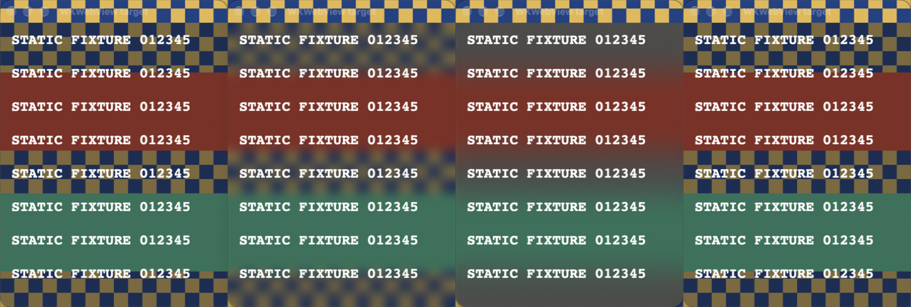

# Ghostty/Zed blur comparison and native follow-up

**Investigation, not a production change.** Public upstream source was pinned on
2026-10-18 UTC. Native experiments ran in the existing isolated probe on macOS
27.0.1 (26A434), Apple Silicon. Neither Ghostty, Zed nor Nimrod was built/launched
for this comparison. Only the probe was rebuilt and run; its existing scoped
Screen Recording grant continued working without further resets.

## Ghostty: same native primitive, no demonstrated enable-flash fix

Pinned revision: [`73e4ff10fb2b30d1ab6e6f7f52ef33f3a0593dcc`](https://github.com/ghostty-org/ghostty/commit/73e4ff10fb2b30d1ab6e6f7f52ef33f3a0593dcc).

- [`ghostty_set_window_background_blur`](https://github.com/ghostty-org/ghostty/blob/73e4ff10fb2b30d1ab6e6f7f52ef33f3a0593dcc/src/apprt/embedded.zig#L2427-L2455)
  calls `CGSSetWindowBackgroundBlurRadius(CGSDefaultConnectionForThread(), windowNumber, radius)`.
  No update batch, return-code check, prewarming or explicit presentation fence.
  At opacity below 1 it sends radius 0 for disabled blur. At opacity 1 it returns
  without calling the setter, unlike Nimrod's explicit removal at opaque opacity.
- [`TerminalWindow.syncAppearance`](https://github.com/ghostty-org/ghostty/blob/73e4ff10fb2b30d1ab6e6f7f52ef33f3a0593dcc/macos/Sources/Features/Terminal/Window%20Styles/TerminalWindow.swift#L520-L559)
  skips invisible windows, reapplies appearance and configured shadow, and sets a
  non-opaque **white alpha 0.001** backing before numeric blur. Native fullscreen
  and forced-opaque modes take the opaque path. Glass styles are a separate path,
  not the implementation of its adjustable numeric blur.
- Live reload is real: core config updates reach surface-derived config, and the
  focused surface's publisher schedules `syncAppearance` on the main queue
  ([subscription](https://github.com/ghostty-org/ghostty/blob/73e4ff10fb2b30d1ab6e6f7f52ef33f3a0593dcc/macos/Sources/Features/Terminal/TerminalController.swift#L1513-L1542)).
  [`showWindow`](https://github.com/ghostty-org/ghostty/blob/73e4ff10fb2b30d1ab6e6f7f52ef33f3a0593dcc/macos/Sources/Features/Terminal/TerminalController.swift#L1169-L1203)
  separately syncs after native reveal. It does not avoid live enabling by doing
  every blur operation before first show.
- Ghostty's IOSurface/Metal-rendered content differs from the probe and WKWebView
  ([layer setup](https://github.com/ghostty-org/ghostty/blob/73e4ff10fb2b30d1ab6e6f7f52ef33f3a0593dcc/src/renderer/Metal.zig#L91-L130)).
  We did not recreate its renderer or run Ghostty, so do not claim its app flashes.

### Tested differences

All these runs used the original checkerboard, no update batch, and three enables
per AppKit/WKWebView target. The unchanged control had no detected grey frames.

| Probe mode | Frames | AppKit captured grey enables | WKWebView captured grey enables |
| --- | ---: | ---: | ---: |
| `ghostty-thread`: thread-default connection | 680 | 2/3 | 3/3 |
| `ghostty-white`: above + white alpha .001 backing | 678 | 1/3 | 1/3 |
| `ghostty-sync`: above + repeat appearance/shadow/backing setters | 683 | 3/3 | 3/3 |

On the probe's main thread, `CGSDefaultConnectionForThread()` and
`CGSMainConnectionID()` returned the **same ID**. Local SkyLight disassembly shows
that the thread-default API has a TLS/new-connection path, so they should not be
called universally equivalent; they were equivalent in this measured setup.
The explicit-zero history is already covered by the original probe's repeated
0→7 cycles: each later enable follows a successful visible-window radius-0 call.

These differences do not fix the reproduction. Counts are not failure-rate
comparisons: PNG capture drops frames, so 1/3 does not establish an improvement.

### Issue-history scope

Scoped source/issue searches found no report specifically matching the isolated
single-grey-frame 0→nonzero transition. Relevant but distinct reports include:

- [#1181](https://github.com/ghostty-org/ghostty/issues/1181) /
  [#1189](https://github.com/ghostty-org/ghostty/pull/1189): blur applied to an
  invisible restored window has no effect.
- [#13341](https://github.com/ghostty-org/ghostty/pull/13341): post-show appearance
  sync for cold-open opacity, not a live enable-flash fix.
- [#14187](https://github.com/ghostty-org/ghostty/issues/14187): tab switching after
  display disconnect/reconnect; [#1470](https://github.com/ghostty-org/ghostty/issues/1470)
  and [#3322](https://github.com/ghostty-org/ghostty/issues/3322): transparency artifacts
  around tabs/panes. Different triggers, not proof about this transition.

## Zed: a distinct native backend, including live existing-window updates

Pinned revision: [`56934ec0560bce8929025497411de7f5322fb6ca`](https://github.com/zed-industries/zed/commit/56934ec0560bce8929025497411de7f5322fb6ca).

Zed's current macOS backend **does not use the numeric WindowServer radius setter**:

- The [native appearance setter](https://github.com/zed-industries/zed/blob/56934ec0560bce8929025497411de7f5322fb6ca/crates/gpui_macos/src/window.rs#L1866-L1902)
  sets transparent renderer/window backing (black alpha .0001), inserts a custom
  `NSVisualEffectView` below rendered content when blurred, and removes it otherwise.
  It lazily creates/removes the effect; it does **not** keep residual blur at zero.
- The [effect implementation](https://github.com/zed-industries/zed/blob/56934ec0560bce8929025497411de7f5322fb6ca/crates/gpui_macos/src/window.rs#L3808-L3882)
  uses `UnderWindowBackground`, `BehindWindow`, `Active`. After AppKit's `updateLayer`,
  it clears layer background colors, hides `CAChameleonLayer` desktop tint and removes
  a saturation filter. The source specifically notes that the older `Selection`
  material has no `CABackdropLayer` on macOS 27.
- This is not startup-only. A [SettingsStore observer](https://github.com/zed-industries/zed/blob/56934ec0560bce8929025497411de7f5322fb6ca/crates/zed/src/main.rs#L793-L804)
  iterates existing windows and calls `set_background_appearance`.
  [Theme-setting reload](https://github.com/zed-industries/zed/blob/56934ec0560bce8929025497411de7f5322fb6ca/crates/theme_settings/src/theme_settings.rs#L104-L154)
  and [theme preview writes](https://github.com/zed-industries/zed/blob/56934ec0560bce8929025497411de7f5322fb6ca/crates/theme_selector/src/theme_selector.rs#L259-L271)
  use SettingsStore. This confirms normal setting/preview routing, not every possible
  direct global-theme/system-appearance path.

Zed's upstream path is fixed material blur, **not an adjustable-radius implementation**.
Its private-layer cleanup needs OS-specific maintenance; the macOS 27 material
change is a concrete example. [#10993](https://github.com/zed-industries/zed/issues/10993)
and [#27403](https://github.com/zed-industries/zed/pull/27403) address shadow/transparency
problems, not documented acceptance of this enable-only flash. No matching macOS
fix was found in the bounded issue search. [#63134](https://github.com/zed-industries/zed/pull/63134)
concerns Windows first-show flashing and is not a macOS workaround.

## Native follow-up: promising material-backed candidate

The probe independently implements the same material policy in `ZedProbeEffect`.
It is not copied GPUI code: the filter traversal removes all matching saturation
filters rather than only the first. Stock material is a comparison mode. Both use
a wrapper content view, insert the effect below static AppKit/WKWebView content,
and remove it at zero. No legacy WindowServer blur call is made in these modes.

- `zed-material`: 714 captured frames; no detected grey frame across six enables.
- `system-material`: 721 frames; no detected grey frame, but the normal dense material
  tint visibly changes the scene. Not a suitable unchanged-opacity replacement.
- `zed-landmarks`: 784 frames; coarse red/green bands confirm the cleaned effect
  samples the actual backdrop, rather than merely covering the window with grey.

### Adjustable-radius extension (our experiment, not upstream Zed behavior)

In the fixture only, `materialRadius: true` replaces the material's Gaussian filter
with a **copied filter** carrying the requested `inputRadius`, after AppKit updates.
The native log reports one configured Gaussian filter. Nonzero changes reuse the
view; zero removes it. This does not leave a warm nonzero radius behind.

To reproduce this candidate explicitly from a task worktree (choose a fresh directory):

```sh
bash tools/blur-probe/probe.sh build
mkdir -p tmp/blur-probe/zed-candidate
printf '%s\n' '{"displayCapture":true,"material":"zed","materialRadius":true,"landmarks":true}' > tmp/blur-probe/zed-candidate/options.json
bash tools/blur-probe/probe.sh run tmp/blur-probe/zed-candidate plain
python3 tools/blur-probe/summarize.py tmp/blur-probe/zed-candidate
```

The initial in-place filter mutation was **not sufficient**: 7 and 20 produced
byte-identical cropped captures despite successful KVC calls/logging. Copying the
filter and replacing the layer's filter array made the output change. Do not treat
an assigned property or a successful native call as proof that blur strength changed.

| Copied-filter run | Scene | Frames | Target enables | Detected grey frames |
| --- | --- | ---: | ---: | ---: |
| `zed-radius-copy` | Checkerboard + coarse color bands | 758 | 6 | 0 |
| `zed-radius-repeat-a` | Original checkerboard | 684 | 6 | 0 |
| `zed-radius-repeat-b` | Checkerboard + coarse color bands | 773 | 6 | 0 |

Across these three runs: **18 target enables, 2,215 captured frames, no detected grey
substitute frame**. The control stays stable. An interleaved original-setter control,
`upstream-baseline-landmarks`, still reproduced the grey flash on both target types
(755 frames; 3/3 AppKit, 2/3 WKWebView enables captured grey).

Pixel inspection of the copied-filter run verified actual softening at 7, stronger
softening at 20, and sharp checkerboard/band edges again after removal. For the
300×380 WKWebView crop `(390,90)`, mean absolute RGB-byte difference was ~4.04 between
7 and 20; before-zero versus returned-zero differed by only ~0.02 (minor capture/
render variation), not blur. The earlier ineffective in-place version had exactly
zero difference between 7 and 20. These are scene comparisons, not blur calibration.



The image uses target-only crops of `zed-radius-copy` frames 108/433/484/539, phases
0/6/7/8. All pixels depict the synthetic fixture. Raw logs/captures remain local and
ignored; only the small contact sheet is tracked.

## Recommendation and remaining gates

**Worth a product-integration task:** use the Zed-style material-backed approach as
an experimentally supported candidate, rather than more timing changes around
`CGSSetWindowBackgroundBlurRadius`. The observed flash is not evidence that all
macOS native blur paths must flash. A persistent effect at zero is not required by
this successful fixture; insertion/removal itself was exercised.

This is **not yet a Nimrod fix** or a guarantee of flicker-free presentation:

- Requested 60 Hz capture can miss frames; the grey threshold is calibrated to the
  original scene. The coarse-band runs were also inspected visually. No full suite
  of visual artifacts, frame-time distribution or streaming performance was measured.
- Only static content, two positive radii and one OS/build were exercised. Strength
  mapping, opacity 0/50/100, light/dark themes and Reduce Transparency still need
  targeted coverage.
- The fixture effect covers the **content rectangle**, not the native title bar.
  Native title-bar tint/blur, native corner clipping, live resize, fullscreen,
  minimize/restore, accessibility refresh and idle/focus lifecycle remain gates.
- The production integration must own a specific view and its cleanup, preserve
  WKWebView focus/input/scroll, and reapply numeric state after AppKit rebuilds its
  material layers. Runtime capability/fallback/error handling must be explicit.
- Tint removal and Gaussian-filter replacement rely on private layer/filter details,
  beyond the existing private radius API. No private view walking/filter edits have
  been added to Nimrod. No new OS, App Store or platform support claim is made.

No production code changed. No new changelog fix entry is warranted for this
investigation; the shipped enable-flash limitation still applies.
